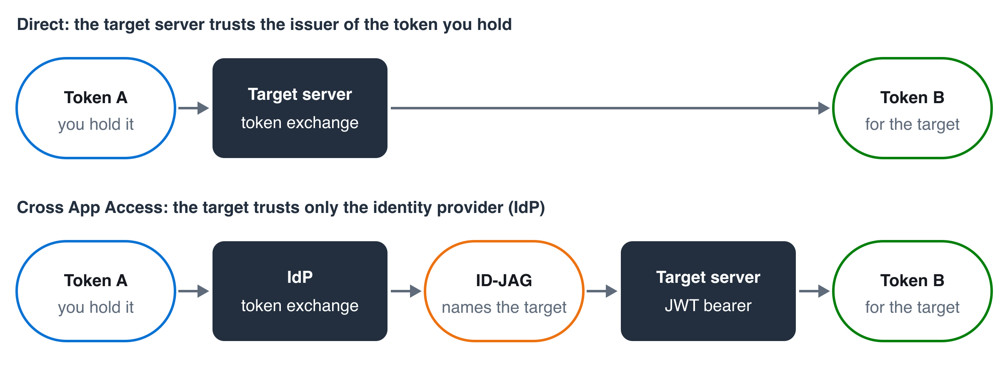
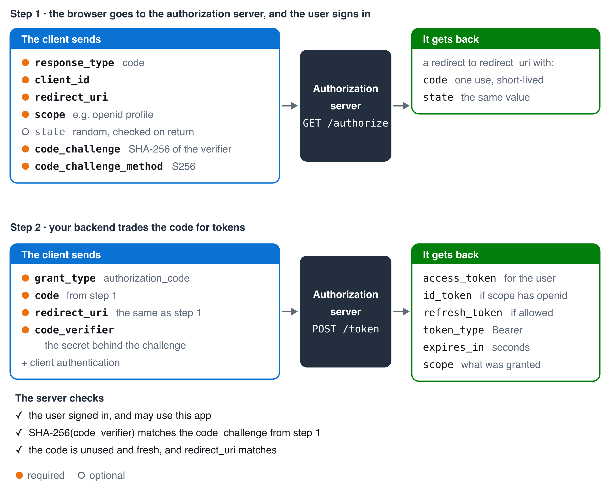
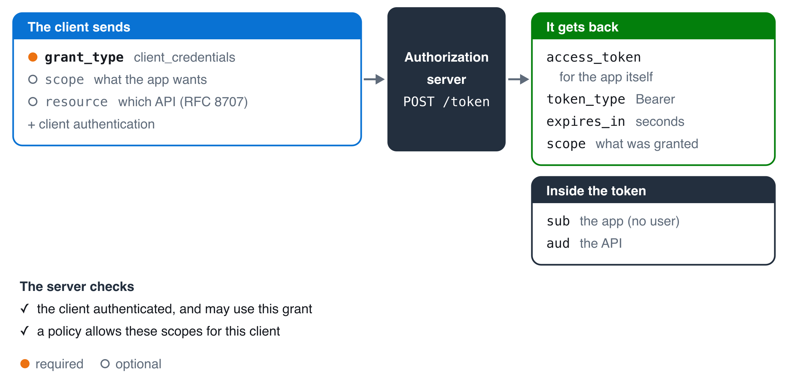
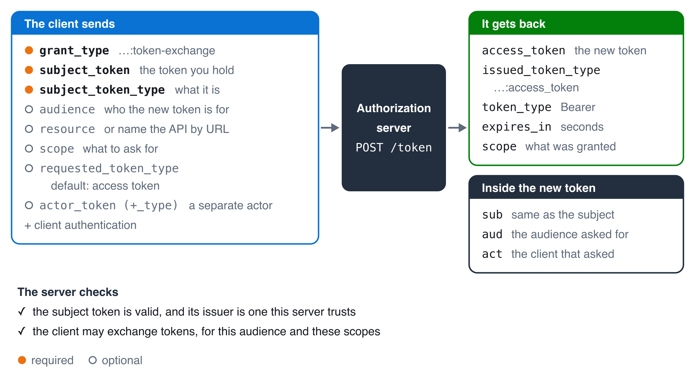
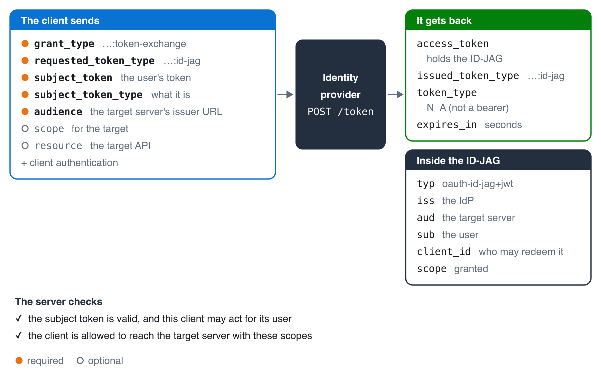
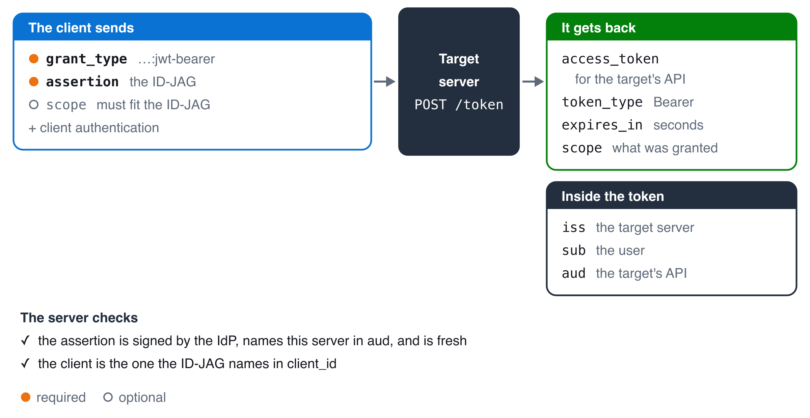
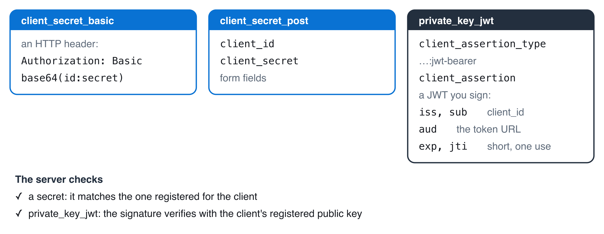

# OAuth token requests: what goes in, what comes out

Each request below is one call to an authorization server. For each, you'll find what the client sends, what it gets back, what the token inside says, and what the server checks.

In the diagrams, an orange dot marks a required parameter and a hollow dot an optional one. Every token request also carries the [client's authentication](#client-authentication).

| Request | `grant_type` | In | Out |
|---|---|---|---|
| [Authorization code + PKCE](#authorization-code--pkce) | `authorization_code` | a code from the user's sign-in | the user's tokens |
| [Client credentials](#client-credentials) | `client_credentials` | only the client's own credentials | a token for the app itself |
| [Token exchange](#token-exchange) | `urn:ietf:params:oauth:grant-type:token-exchange` | a token you hold | a new token for another audience |
| [Token exchange for an ID-JAG](#token-exchange-for-an-id-jag) | the same token exchange grant | a token you hold | an ID-JAG for another server |
| [JWT bearer](#jwt-bearer) | `urn:ietf:params:oauth:grant-type:jwt-bearer` | a signed JWT (here, the ID-JAG) | an access token |

## Two ways to get a token for another server



- **Direct:** one token exchange at the target server. It works only if the target trusts whoever issued the token you hold.
- **Cross App Access:** two requests. The identity provider (IdP) issues an ID-JAG naming the target server, and the target server trades the ID-JAG for its own access token. The target only has to trust the IdP.

## Authorization code + PKCE

*RFC 6749 §4.1, with PKCE from RFC 7636.* A user signs in, and the app gets tokens for them.



- **PKCE** keeps a stolen code useless. The app makes a random `code_verifier`, sends only its SHA-256 hash (`code_challenge`) in step 1, and proves it holds the verifier in step 2.
- **`state`** is optional in the spec, but send it: it ties the redirect back to the request your app made.
- **`id_token`** comes back only when `scope` includes `openid` (OpenID Connect). It tells the app who signed in; the `access_token` is what you send to APIs.

## Client credentials

*RFC 6749 §4.4.* An app gets a token for itself. There's no user and no refresh token.



- **`resource`** (RFC 8707) names the API the token is for, so the server can set `aud` to it.

## Token exchange

*RFC 8693.* Trade a token you hold for a new one. Usually the new token is for a different audience, and it still names the same user.



- **`subject_token_type`** is required: it tells the server how to read and validate `subject_token`. The values are [listed below](#token-type-identifiers).
- **`requested_token_type`** is optional. Leave it out to get an access token.
- **`audience`** and **`resource`** both say who the new token is for: `audience` by name, `resource` by URL.
- **`act`** in the new token names who is acting for the user. Each further exchange nests the previous actor inside it.
- **`actor_token`** names a second party as the actor. Some servers instead take the actor from the client that authenticates and don't accept `actor_token` at all.
- **`issued_token_type`** in the response says what you got back.

## Token exchange for an ID-JAG

*Cross App Access step 1: Identity Assertion JWT Authorization Grant (IETF draft).* The same token exchange, sent to the identity provider, asking for an ID-JAG instead of an access token.



How it differs from a plain token exchange:
- **`requested_token_type`** is required: `urn:ietf:params:oauth:token-type:id-jag`.
- **`audience`** is the target server's **issuer URL**: the server that will redeem the ID-JAG, not the API.
- **The response:** the ID-JAG comes back in the `access_token` field, but it isn't an access token. That's why `token_type` is `N_A`; you can't call an API with it.
- **Inside the ID-JAG:**
  - the header `typ` is `oauth-id-jag+jwt`;
  - `aud` names the target server;
  - `client_id` names the client that may redeem it.

## JWT bearer

*RFC 7523 §2.1. Cross App Access step 2.* Trade a signed JWT for an access token. In Cross App Access, the JWT is the ID-JAG.



- **No token types.** The input is always a JWT and the output is always an access token, so this grant has no `subject_token_type` and no `requested_token_type`. The server recognizes an ID-JAG from its `typ` header.
- **The target server trusts the IdP's signature**, not the token the ID-JAG was made from. It never sees that token.

## Client authentication

*RFC 6749 §2.3 (secrets); RFC 7523 §2.2 (`private_key_jwt`).* Every token request carries one of these, alongside the parameters above.



- **A secret** travels with every request, and the server keeps a copy of it.
- **`private_key_jwt`** sends a short-lived JWT signed with the client's private key. Only the public key is registered, and the private key can stay in a key service such as AWS KMS. Each assertion names the token URL it's sent to (`aud`) and is used once (`jti`), so a new one is made for every request.

## Token type identifiers

The values for `subject_token_type`, `requested_token_type` and `issued_token_type`. Each is `urn:ietf:params:oauth:token-type:` followed by:

| Suffix | The token is |
|---|---|
| `access_token` | an OAuth access token |
| `refresh_token` | an OAuth refresh token |
| `id_token` | an OpenID Connect ID token |
| `jwt` | some other JWT |
| `saml1`, `saml2` | a SAML assertion |
| `id-jag` | an Identity Assertion JWT (Cross App Access) |

Which types a server accepts is up to the server. A server may refuse `jwt` for a token it could read as an `access_token`.

## With AgentCore Identity

The `@requires_access_token` decorator builds these requests for you. With `auth_flow="ON_BEHALF_OF_TOKEN_EXCHANGE"` each request parameter comes from one place:

| Request parameter | Where it comes from |
|---|---|
| `subject_token` (token exchange) or `assertion` (JWT bearer) | the JWT bound to the workload access token. On AgentCore Runtime, the Runtime binds the caller's bearer token for you. Elsewhere, call `IdentityClient.get_workload_access_token(workload, user_token=jwt)`, then `BedrockAgentCoreContext.set_workload_access_token(...)`. |
| `grant_type` | the credential provider's `onBehalfOfTokenExchangeConfig.grantType`: `TOKEN_EXCHANGE` or `JWT_AUTHORIZATION_GRANT` |
| the token URL, `client_id` and client authentication | the credential provider: its discovery URL, client ID, and client secret or KMS key |
| `scope` | the decorator's `scopes` |
| `subject_token_type`, `requested_token_type`, `audience`, `resource` | the decorator's `custom_parameters`, sent as form fields |

The decorator's `force_authentication=True` asks the server again on every call instead of reusing a token from AgentCore's token vault.

```python
# Token exchange for an ID-JAG (provider grant type: TOKEN_EXCHANGE)
@requires_access_token(provider_name="idp-token-exchange", scopes=["api.read"],
                       auth_flow="ON_BEHALF_OF_TOKEN_EXCHANGE", force_authentication=True,
                       custom_parameters={"subject_token_type": "urn:ietf:params:oauth:token-type:access_token",
                                          "requested_token_type": "urn:ietf:params:oauth:token-type:id-jag",
                                          "audience": "https://target-as.example.com"})
async def get_id_jag(*, access_token):
    return access_token          # the ID-JAG

# JWT bearer with the ID-JAG (provider grant type: JWT_AUTHORIZATION_GRANT); bind the ID-JAG first
@requires_access_token(provider_name="target-jwt-bearer", scopes=["api.read"],
                       auth_flow="ON_BEHALF_OF_TOKEN_EXCHANGE", force_authentication=True)
async def redeem_id_jag(*, access_token):
    return access_token          # the target server's access token
```

To regenerate the diagrams after editing them: `python3 docs/images/make_token_flows.py` (needs `rsvg-convert`).
